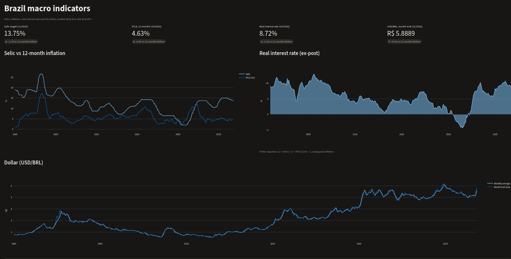
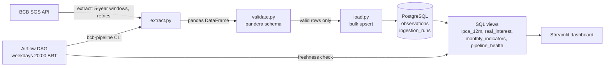

# bcb-pipeline

[](https://github.com/Arthur-Rudiger/bcb-pipeline/actions/workflows/ci.yml)


An ETL pipeline that loads Brazilian macroeconomic series from the **Banco Central do Brasil SGS API**
into **PostgreSQL**. Every batch is validated, loads are idempotent and incremental, and each run is
recorded in an audit log. SQL views turn the raw data into indicators such as compounded 12-month
inflation and the real interest rate, which a **Streamlit** dashboard displays. **Airflow** schedules
the runs and **GitHub Actions** tests every change.



## What it loads

| SGS code | Series | Frequency | Rows (2000 to today) |
|---:|---|---|---:|
| 432 | Selic target rate (% p.a.) | daily | ~9,800 |
| 433 | IPCA, monthly change (%) | monthly | ~320 |
| 1 | USD/BRL exchange rate, sell | business days | ~6,700 |

## Architecture



## Quickstart

Requirements: Docker, Python 3.11+.

```bash
git clone git@github.com:Arthur-Rudiger/bcb-pipeline.git && cd bcb-pipeline
cp .env.example .env
docker compose up -d                      # Postgres 16; schema and views are created on first start
python -m venv .venv && source .venv/bin/activate
pip install -e ".[dev,dash]"
bcb-pipeline                              # first run: full backfill from 2000 (about a minute)
streamlit run dashboard/app.py            # http://localhost:8501
```

Scheduled runs with Airflow (optional):

```bash
docker compose --profile airflow up -d --build   # UI at http://localhost:8080
```

## Usage

```bash
bcb-pipeline                       # incremental: re-fetch the last 45 days of every series
bcb-pipeline --series 432 433      # only some series
bcb-pipeline --full                # re-fetch everything from 2000
```

The command exits with **0** if all series succeeded, **1** if any series failed (the others are
still loaded) and **2** for invalid arguments, so cron, Airflow or CI can act on the result.

```
  series status   from        fetched    new   upd
       1 success  2026-10-05       32      0     0
     432 success  2026-10-06       46      0     0
     433 success  2026-08-17        3      0     0
```

This is a second run on the same day: everything re-fetched in the 45-day lookback was
already there, so nothing was inserted or updated.

## Design decisions

- **Extraction.** The API rejects windows longer than 10 years and daily series without dates, so
  requests use 5-year windows. They retry with exponential backoff on 429/5xx, and a "no data" 404 is
  told apart from a "series does not exist" 404.
- **Validation before loading.** A [pandera](https://pandera.readthedocs.io) schema checks types,
  plausible ranges per series (Selic 0–50%, for example), future dates and duplicates. It runs
  lazily, so one report lists every problem. Invalid batches are never written.
- **Idempotent, incremental loads.** A single bulk `INSERT ... ON CONFLICT DO UPDATE` with
  `unnest()` upserts each batch, and `RETURNING (xmax = 0)` counts inserted, updated and unchanged
  rows. Incremental runs re-fetch 45 days so the pipeline picks up revisions to published values.
  Running it twice changes nothing.
- **Audit log.** Every run writes to `ingestion_runs` (start, end, status, row counts, error) in its
  own transaction, so a failure is recorded even when the data load is rolled back.
- **Failure isolation.** One series failing doesn't stop the others. Airflow runs one task per series,
  each retried on its own.
- **Transformations in SQL** ([`sql/003_views.sql`](sql/003_views.sql)), versioned with the schema:
  - `ipca_12m`: inflation is **compounded**, not summed: `exp(sum(ln(1 + m/100)))` over a
    calendar-based `RANGE` window, so a missing month shrinks the window instead of stretching it.
  - `real_interest`: the **Fisher equation** `(1 + Selic) / (1 + IPCA 12m) − 1`, not subtraction.
  - `pipeline_health`: last value, last run, and a staleness flag that allows for monthly series
    being published weeks after the reference month.

## Validation against official data

The Banco Central publishes 12-month IPCA itself as series **13522**. Comparing it with the
`ipca_12m` view:

| Months compared | Exact match | Max difference |
|---:|---:|---:|
| 311 | 301 | 0.01 pp |

The small differences are expected. IBGE compounds full-precision index numbers, while the monthly
rates published in series 433 are rounded to two decimals.

## Some results

- **Highest real interest rate since 2000:** August 2005, **12.95%** (Selic 19.75%, IPCA 6.02%).
- **Lowest:** July 2021, **−4.35%** (Selic 4.25%, IPCA 8.99%). 2021 is the only year with a
  negative average real rate (−3.21%), after the post-pandemic inflation spike.

The real rate here is **ex-post**: it uses inflation that has already happened. An **ex-ante** measure
would use expected inflation from the BCB Focus survey, which would be a good next step.

## Tests and CI

```bash
pytest          # 46 tests; database tests use a transaction that is always rolled back
ruff check .
```

- Extraction tests run offline, with a saved API response and a fake HTTP session.
- Load, pipeline and view tests run against a real Postgres. The view tests use hand-made data with
  known answers, such as 1% a month giving 12.68% a year, not 12%.
- GitHub Actions starts a Postgres 16 service container, applies the migrations in `sql/` and runs
  ruff and pytest on every push and pull request. In CI, database tests fail instead of skipping
  when the database is missing, so a green run really means every test ran.

## Project layout

```
src/bcb_pipeline/   extract.py · validate.py · load.py · pipeline.py (CLI) · config.py
sql/                001_schema.sql · 002_run_counts.sql · 003_views.sql
dags/               bcb_daily.py (Airflow)
dashboard/          app.py (Streamlit)
tests/              46 tests (pytest)
docker/             airflow.Dockerfile
```

## Tech stack

Python 3.14 · pandas · pandera · SQLAlchemy 2 + psycopg 3 · PostgreSQL 16 · Docker Compose ·
Apache Airflow 3 · Streamlit + Plotly · pytest · ruff · GitHub Actions

## License

MIT
